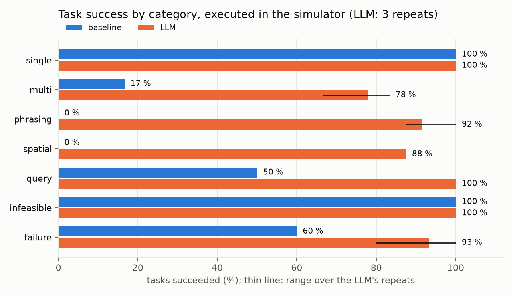
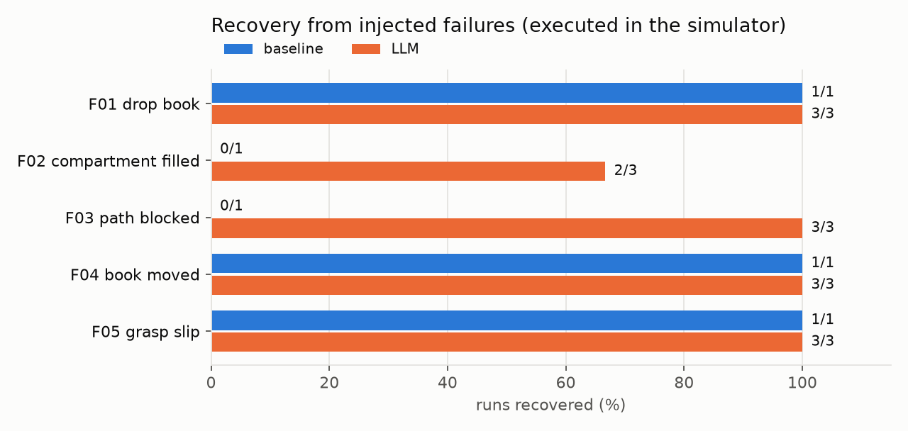
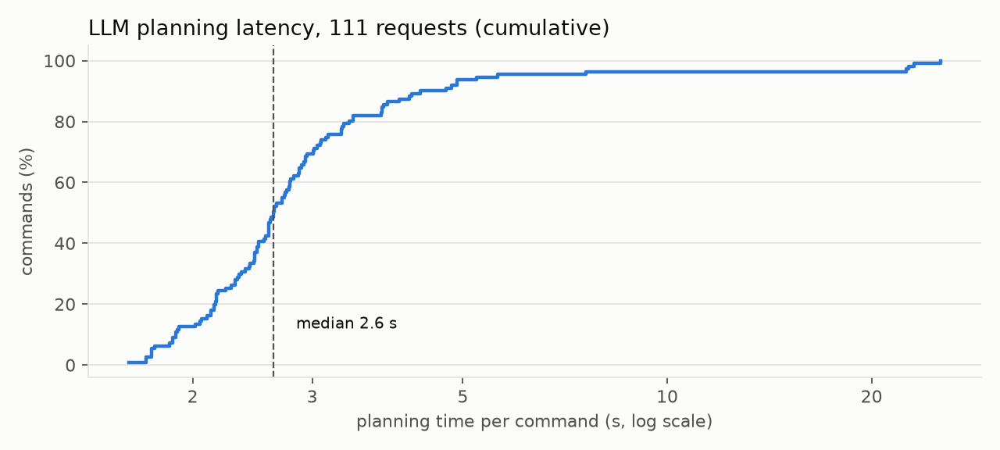

# ShelfSage: an LLM-guided mobile librarian robot

*Final report, Robot Manipulators course project. Simulation in MuJoCo; all numbers below come from `benchmark/results/` and can be reproduced with the commands in Section 7.*

## Abstract

ShelfSage is a mobile manipulator (a Franka Panda arm on a holonomic base) that moves books in a simulated library on a natural-language command, e.g. *"Take the book on Table D and put it in the empty compartment nearest to the window."* The language model only plans: it turns the command and a JSON description of the library into a short list of skill calls (FIND_BOOK, NAVIGATE, GRASP, PLACE, VERIFY), and conventional controllers execute them: A* navigation on a particle-filter (MCL) pose estimate, our own inverse kinematics, a friction grasp, and a YOLOv8 detector on the wrist camera. We compare this LLM planner with a rule-based baseline on a 42-task benchmark that was written before the LLM planner. Executed in the simulator, the baseline completes 17 of 42 tasks (40 %) and the LLM planner 116 of 126 runs (92 %, three repeats per task; exact McNemar p = 5 × 10⁻⁷). The baseline only handles its command templates; the LLM also handles new wordings, spatial relations, several books per command and recovery after injected failures. Most of the LLM's remaining misses are not planning errors: half come from one manipulation limit (placing a book into the fourth slot of a compartment).

## 1. Problem and approach

A library robot has to understand requests phrased in many ways and still move books safely and precisely. Writing rules for every phrasing does not scale; letting a language model drive the robot directly is neither safe nor verifiable. ShelfSage separates the two:

- **The LLM plans, proven controllers execute.** The model sees a world-state JSON (books, tables, compartments, free slots, the robot) with spatial facts pre-computed in code (distances to the window and to every table, rows, neighbours) and returns a JSON plan over five skills. It is called once per command, before anything moves.
- **Every plan is validated.** A symbolic validator steps the plan through the world state (hand empty before GRASP, robot at the book's place, a free slot for PLACE, ...) and sends errors back to the model; nothing invalid reaches the robot.
- **Same skills for both planners.** The baseline and the LLM call the same skills, so only the planner changes in the comparison.

## 2. The system

| Part | What it does | Where |
|---|---|---|
| Scene | 8 × 8 m library: 6 tables, 3 shelves (24 compartments), 39 books (22 × 15 × 4 cm with 1 cm ribs so a fingertip fits underneath), modern decor with collision boxes in the map, robot work zones | `scene/` |
| Robot | Panda on a holonomic base, two 270° LiDARs, noisy wheel odometry, wrist RGB-D camera | `scene/robot_model.py`, `sim/robot.py` |
| Arm control | Own DH forward kinematics, Jacobian, damped least-squares IK with null-space posture control, straight-line moves, guarded moves on simulated fingertip force | `control/`, `sim/robot.py` |
| Perception | YOLOv8n-seg trained on 4000 auto-labelled simulator images; mask + depth -> book centre and yaw | `perception/` |
| Navigation | A* in a two-band configuration space, MCL with a LiDAR likelihood field (4-10 mm error), LiDAR obstacle detection and replanning | `control/`, `skills/navigation.py` |
| Skills | GRASP from a table (dragging books to the edge, pushing blockers aside) or a shelf; PLACE in a compartment or on a table; tactile retry; honest failure reporting | `skills/` |
| Planning | World model, plan validator, executor with step logs, rule-based baseline, LLM planner, replanning after failures | `planner/` |

**LLM.** Google Gemini 3.5 Flash-Lite on the free API tier, effort medium, structured JSON output. A Claude backend is implemented too, but the Claude API has no free tier. Free-tier daily request limits forced caching of answers and a stop-and-resume runner, and ruled out larger free models (20 requests per day, or overloaded).

## 3. Benchmark and method

The benchmark (`benchmark/tasks.json`, 42 tasks) was fixed before the LLM planner was written, so the prompt could not be tuned to it. The prompt's examples use other books and wordings.

| Category | n | Examples |
|---|---|---|
| single | 8 | "Put Machine Learning in S2-A3" (template wording) |
| multi | 6 | "Swap Physics and Linear Algebra", "Clear Table E" |
| phrasing | 8 | "I need the physics textbook on table A, please" |
| spatial | 8 | "the empty compartment nearest to the window", "the book standing next to Physics" |
| query | 4 | "Is Machine Learning in S2-A3?" |
| infeasible | 3 | unknown book, full table: must be refused |
| failure | 5 | a dropped book, a filled compartment, a blocked table, a moved book, a slipped grasp, injected while the plan runs |

A task succeeds when its goal holds in the final simulated world, no other book has moved, every step succeeded and, for failure tasks, the hand is empty at the end. Failure tasks allow up to two replans, with the new world state and a description of what went wrong. Every run starts from the reset scene, with the robot pose from MCL and book poses from simulator ground truth. The baseline is deterministic and was run once. The LLM was run three times, because its answers vary between runs. We report pooled rates with 95 % Wilson intervals and an exact McNemar test on the paired per-task outcomes (LLM: majority of its three runs).

## 4. Results



| Category | Baseline (executed) | LLM plan level (3 runs) | LLM executed (3 runs) |
|---|---|---|---|
| single | 8/8 | 24/24 | 24/24 |
| multi | 1/6 | 16/18 | 14/18 |
| phrasing | 0/8 | 22/24 | 22/24 |
| spatial | 0/8 | 24/24 | 21/24 |
| query | 2/4 | 12/12 | 12/12 |
| infeasible | 3/3 | 9/9 | 9/9 |
| failure | 3/5 | (exec only) | 14/15 |
| **all** | **17/42 = 40 % [27-56]** | **107/111 = 96 % [91-99]** | **116/126 = 92 % [86-96]** |

- **Paired comparison** (42 tasks): both succeed 17, only the LLM 22, only the baseline 0, neither 3; McNemar p = 4.8 × 10⁻⁷. The LLM never loses a task the baseline wins.
- **Planning cost:** median 2.6 s per command (90th percentile 4.3 s, maximum 25 s when the API was busy), about 6.4k input and 0.7k output tokens. No plan in 111 requests needed a validator retry.
- **Execution:** a successful task takes a median of 93 s simulated with the LLM (75-271 s; the swap is 12 steps) and 121 s with the baseline, whose easier tasks include drags across tables.



**Failures and replanning.** Both planners recover when re-running the same command against the new world is enough: a dropped or slipped book, or a book someone moved. Only the LLM recovers when the plan itself must change. When Table D was blocked, it laid the book back on Table E and said why (3/3). When the target compartment was filled meanwhile, it chose another compartment of the same shelf (2/3). The baseline kept retrying the same impossible target and ended with the book still in its gripper.



## 5. Where it still fails

The 10 unsuccessful LLM runs out of 126:

| Cause | Runs | Detail |
|---|---|---|
| Manipulation limit: 4th slot of a compartment | 5 | X02 (3×), M06, M04: placing next to three standing books, the arm stops ~7 mm short and the set-down never reaches the board. The skill now aborts, keeps the book and reports it (it used to let go and report success, found in Phase 9). The plans were right. |
| Refusal of an under-specified command | 4 | "Clear Table E", "Put away Linear Algebra": in 2 of 3 runs the model refused because no destination was named; in the other run it chose a shelf. |
| Lost book after an aborted placement | 1 | F02 run 3: the second placement after an abort lost the book (probably shifted in the fingers). |

So with the LLM, **the planner is no longer the bottleneck: the skills are.** Fixing the fourth-slot placement, for example by sliding the base along the shelf before inserting, would remove half of the remaining misses.

## 6. Development notes and honest caveats

- **Prompt versions.** v1 answered a yes/no question with FIND_BOOK because of a contradictory example; v2 fixed that example; v3 added a section on replanning ("never leave a book in the gripper after a failure"). v2 and v3 were changed after seeing results, so all versions' numbers are kept in `benchmark/results/` and in the README. The final evaluation above uses v3 throughout.
- **Variance.** The same command can get different answers across runs (e.g. "Put away Linear Algebra"). With 3 runs per task the pooled rates have the intervals shown; more runs would narrow them, within the free-tier limits.
- **Simplifications.** Book poses for planning come from simulator ground truth (the detector is used inside the skills and was validated separately: 32/32 books found). The start pose is known (no global localization). Failures are injected by teleporting objects, not by simulating their physical cause.
- **Bugs found by the tests along the way:** a guarded set-down pressing 11-14 N instead of 2.5 N; the shelf swing knocking a book out of the row above; a base back-off hitting chairs; PLACE reporting success after a failed set-down. Each is described in the README with the fix and the re-run tests.

## 7. Reproducing

```
python benchmark/run_eval.py --level exec                          # baseline, all 42 tasks
python benchmark/run_eval.py --planner llm --repeat 1              # LLM, plan level (GEMINI_API_KEY in .env)
python benchmark/run_eval.py --planner llm --level exec --repeat 1 # LLM, executed (also --repeat 2, 3)
python benchmark/analyze.py                                        # tables, statistics, plots
python run_demo.py --task X01                                      # watch one task in the viewer
python run_demo.py --task F03                                      # a failure and the replan
```

The phase tests (`sim/test_robot.py`, `sim/test_phase4.py` ... `sim/test_phase9.py`) check each layer. The README's progress tracker documents every design decision and result.
